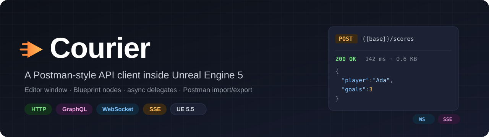
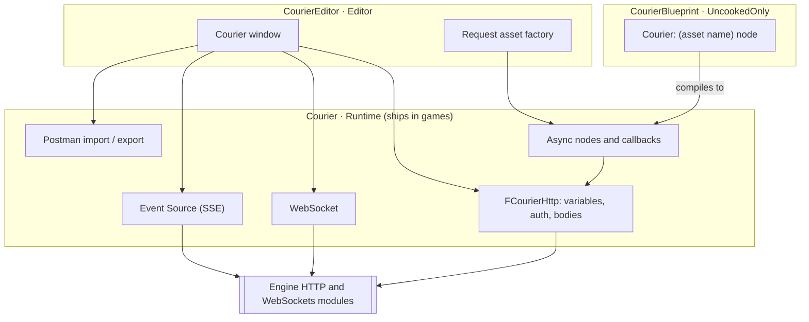

<p align="center">
  
</p>

<p align="center">
  
  
  
  
  
</p>

<p align="center">
  <b>Test your game's APIs without leaving the editor, then call the same requests from Blueprints with one node.</b><br>
  <a href="#quick-start">Quick start</a> ·
  <a href="#whats-included">What's included</a> ·
  <a href="#why-use-courier">Why</a> ·
  <a href="docs/editor-guide.md">Editor guide</a> ·
  <a href="docs/blueprint-reference.md">Blueprint reference</a> ·
  <a href="docs/cpp-reference.md">C++ reference</a> ·
  <a href="docs/postman-compatibility.md">Postman compatibility</a>
</p>

---

<p align="center">
  
  <br><sub>The Courier window (<b>Tools &gt; Courier API Client</b>): a request from a collection, variables resolved from the Staging environment, real response from postman-echo.com.</sub>
</p>

## Why use Courier

Games talk to backends: login, matchmaking, leaderboards, store, telemetry, live events. Without Courier, testing those calls means switching to Postman, then writing the same request again in C++ or Blueprint, then debugging the two copies when they drift apart.

Courier keeps that work in one place:

| Problem | How Courier helps |
|---|---|
| Alt-tabbing to Postman to check an endpoint | The client is an editor tab. Send, inspect status, time, size, headers and pretty JSON without leaving Unreal. |
| The request in Postman and the request in game code drift apart | Save a request as an asset. The **same asset** is what the editor sends and what the Blueprint node sends. |
| Wiring HTTP in Blueprint is verbose (build URL, headers, JSON, bind delegates) | One `Courier: <asset>` node with a pin per `{{variable}}` and **On Success** / **On Failure** outputs. |
| Your team already has Postman collections | Import collections (v2.0, v2.1) and environments; export them back. |
| Dev, staging and live use different hosts and keys | Environments and globals, switched from a combo box; `{{base}}` resolves everywhere. |
| Realtime features (chat, match feeds, live ops) need sockets | WebSocket and Server-Sent Events in the editor console and as Blueprint objects with events. |
| Engine HTTP callbacks arrive off the game thread or need boilerplate | Every Courier callback is delivered on the game thread, through dynamic delegates that work in Blueprint. |

## What's included

Courier is one plugin with three modules. Nothing else to install: it uses the engine's own `HTTP`, `WebSockets` and `Json` modules.

| Part | Module | What it is | Why it is useful |
|---|---|---|---|
| **Courier window** | `CourierEditor` (Editor) | A Postman-style tab: collections, folders, environments, globals, history, request editor, response viewer, stream console. | Explore and debug APIs inside the editor. [Guide](docs/editor-guide.md) |
| **Request assets** | `Courier` (Runtime) | `UCourierRequestAsset`, a data asset holding one request plus default variables. Created from the window (**More > Save as Asset**) or the Content Browser. | A request becomes content: versioned, reviewed, referenced by Blueprints, editable by non-programmers. |
| **`Courier: <asset>` node** | `CourierBlueprint` (UncookedOnly) | A custom K2 node listed once per request asset in the Blueprint context menu, with one input pin per `{{variable}}`. | The shortest path from "it works in the window" to "it works in game". |
| **Async request nodes** | `Courier` | `Send Courier Request`, `Courier GET`, `POST JSON`, `PUT JSON`, `PATCH JSON`, `DELETE`, `POST Form`, `Courier GraphQL`. Latent nodes with **On Success** / **On Failure** pins. | Ad-hoc calls from any Blueprint graph without creating an asset. |
| **Callback functions** | `Courier` | `Send Courier Request With Callback` and `...Asset With Callback`, taking a delegate. | Works inside Blueprint functions and from C++, where latent nodes are not allowed. |
| **WebSocket object** | `Courier` | `UCourierWebSocket`: Connect, Send Text, Send Binary, Close, plus six events. | Chat, match feeds, multiplayer services, dev tools. |
| **Event Source object** | `Courier` | `UCourierEventSource`: a WHATWG-compliant Server-Sent Events client with On Open / On Event / On Closed. | Live ops feeds, progress streams, LLM token streams. |
| **JSON helpers** | `Courier` | `Get Json String / Number / Bool / Array Length / Keys` with paths like `data.users[0].name`, plus `Make Json Object`, `Pretty Print`, `Condense`, `Is Valid Json`. | Read responses in Blueprint without defining a struct for every payload. |
| **Postman interop** | `Courier` | Import and export collections and environments, at edit time and at run time. | Reuse what your backend team already maintains. [Details](docs/postman-compatibility.md) |
| **C++ API** | `Courier` | `FCourierHttp::Send`, `FCourierPostman`, `FCourierSseConnection`, `UCourierWebSocket::MakeSocket`. | Same features without UObjects. [Reference](docs/cpp-reference.md) |
| **Automation tests** | `Courier`, `CourierEditor` | 7 unit tests plus 2 live network tests. | Proves variable resolution, request building, Postman round trips, SSE parsing and the Blueprint node compile. |

## Screenshots

<p align="center">
  
  <br><sub><b>A request asset as a Blueprint node.</b> <code>Courier: CR_PostScore</code> has <b>Base</b>, <b>Season</b> and <b>Player</b> pins because the request uses <code>{{base}}</code>, <code>{{season}}</code> and <code>{{player}}</code>. On Success, the response body goes through <code>Get Json String</code> with the path <code>json.player</code>.</sub>
</p>

<p align="center">
  
  <br><sub><b>Streaming.</b> A Server-Sent Events request connected to Wikimedia's public recent-changes stream. WebSocket requests use the same console, with a message box for sending.</sub>
</p>

## Quick start

**Requirements:** Unreal Engine 5.5 and a C++ toolchain (the plugin ships as source). Tested on Windows 64-bit. A Blueprint-only project needs one C++ class added once so it can build plugins.

1. Clone into your project's `Plugins` folder:

   ```bash
   git clone https://github.com/ahmad-farrag/Courier.git Plugins/Courier
   ```

2. Enable it in your `.uproject` (or **Edit > Plugins > Networking > Courier**):

   ```json
   { "Name": "Courier", "Enabled": true }
   ```

3. Regenerate project files, build the editor target, and open the project.
4. Open **Tools > Courier API Client**, type `https://postman-echo.com/get?hello=world`, press **Ctrl+Enter**.

### Your first request as a Blueprint node

1. In the Courier window, build the request. Use `{{name}}` for anything that changes (`{{base}}/players/{{id}}`).
2. **More > Save as Asset**. Courier creates a `Courier Request` asset (default folder `/Game/Courier`).
3. Open any Blueprint, right-click, type the asset name, pick **Courier: \<asset\>**.
4. Fill the variable pins, wire **On Success** and **On Failure**. Read fields from **Response** with `Break Courier Response` and the JSON helpers.

```text
SubmitMatchScore ──▶ Courier: CR_PostScore ──On Success──▶ Print String (Get Json String(Body, "json.player"))
                     Season = 2026          ──On Failure──▶ Print String ("Score upload failed")
                     Player = Ada
```

### From C++

```cpp
#include "CourierHttp.h"

FCourierRequestSpec Spec;
Spec.Verb = ECourierVerb::Post;
Spec.Url = TEXT("{{base}}/scores");
Spec.BodyType = ECourierBodyType::Json;
Spec.Body = TEXT("{\"player\":\"{{player}}\",\"score\":42}");

FCourierHttp::Send(Spec, { { TEXT("base"), TEXT("https://api.example.com") }, { TEXT("player"), TEXT("Ada") } },
	[](const FCourierResponse& Response)
	{
		UE_LOG(LogTemp, Log, TEXT("%d in %.0f ms: %s"), Response.StatusCode, Response.ElapsedSeconds * 1000.f, *Response.Body);
	});
```

## Feature reference

<details open>
<summary><b>Requests</b></summary>

| | Supported |
|---|---|
| Methods | GET, POST, PUT, PATCH, DELETE, HEAD, OPTIONS, any custom verb |
| Body | none, JSON (with Beautify), raw with any content type, `x-www-form-urlencoded`, `multipart/form-data` (text and file fields), binary file, GraphQL (query + variables) |
| Auth | Bearer token, Basic, API key (header or query string) |
| Variables | `{{name}}` in URL, params, headers, body, auth and form fields. Resolved recursively (up to 4 levels). |
| Dynamic variables | `{{$guid}}`, `{{$randomUUID}}`, `{{$timestamp}}`, `{{$isoTimestamp}}`, `{{$randomInt}}` |
| Precedence (editor) | globals, then collection variables, then the active environment; later wins, as in Postman |
| Precedence (asset nodes) | the asset's Default Variables, then the values passed to the node; passed values win |
| Timeout | per request (default 30 s) |
| Copy as cURL | from the request's **More** menu or the tree's context menu |

</details>

<details>
<summary><b>Responses</b></summary>

`FCourierResponse` carries `bSuccess` (2xx), `bReceivedResponse`, `StatusCode`, `Body` (text), `Content` (bytes), `Headers` (map), `ContentType`, `ElapsedSeconds`, `SizeBytes`, `Error`, `Url` and `Verb`. On Failure fires for non-2xx statuses, network errors (DNS, TLS, refused, timeout) and cancellation, so one branch handles everything that is not a success.

</details>

<details>
<summary><b>Streaming</b></summary>

| | WebSocket | Server-Sent Events |
|---|---|---|
| URLs | `ws://`, `wss://` | `http://`, `https://` (`text/event-stream`) |
| Send | text, binary | (receive only, per the spec) |
| Receive | text; binary (fragments joined first) | `event`, `data` (multi-line), `id`, `retry` |
| Extras | subprotocols, custom headers | custom headers, CRLF/LF/CR line endings, split chunks |
| Events | On Connected, On Connection Error, On Closed (code, reason, clean), On Message, On Binary Message, On Message Sent | On Open (status), On Event, On Closed (error, status) |

</details>

<details>
<summary><b>Editor conveniences</b></summary>

Collections with nested folders, rename / duplicate / move / delete, a filter box, history of the last 200 requests, a live preview of the resolved URL, warnings for unresolved `{{variables}}`, **Ctrl+Enter** to send, **Ctrl+S** to save, console commands `Courier.Open` and `Courier.Send`. The workspace is stored per machine in `Saved/Courier/Workspace.json`; share collections by exporting them.

</details>

## Architecture



The node module is **UncookedOnly**: the node turns into plain function calls when the Blueprint compiles, so packaged games only load the runtime module. More in [docs/architecture.md](docs/architecture.md).

## Compared with Postman

| Feature | Courier |
|---|---|
| HTTP methods, params, headers, all common body types | Yes |
| Bearer, Basic, API key auth (with folder/collection inheritance on import) | Yes |
| Collections, folders, environments, globals, history | Yes |
| GraphQL | Yes |
| WebSocket, Server-Sent Events | Yes |
| Postman collection v2.0 / v2.1 and environment import / export | Yes |
| Code generation | cURL; plus the Blueprint node and C++ API |
| Pre-request and test scripts | No (ignored on import) |
| OAuth 2.0, Digest, AWS Signature, Hawk, NTLM | No (imported without auth, with a log warning) |
| Cookie jar, mock servers, monitors, gRPC, MQTT, Socket.IO | No |

## Python and editor scripts

The latent nodes are Blueprint-only, so scripts use `CourierLibrary.create_courier_request`, bind `on_success` / `on_failure`, then call `send()`.

> **Known UE 5.5 limitation.** Binding a Python callable to a delegate whose parameter is a struct (the response, an SSE event) crashes inside the engine's Python bridge (`PyGenUtil::InvokePythonCallableFromUnrealFunctionThunk`). Delegates with string or int parameters, such as all WebSocket events, work. Blueprint and C++ are not affected.

## Tests

Run from **Tools > Session Frontend > Automation**, or headless:

```bash
UnrealEditor-Cmd.exe YourProject.uproject -ExecCmds="Automation RunTests Courier; Quit" -unattended -nullrhi
```

| Test | Covers |
|---|---|
| `Courier.Variables` | `{{var}}` resolution, nested variables, unknown and unclosed `{{` left as typed, `$guid` / `$timestamp`, variable name discovery |
| `Courier.Prepare` | Verb and URL, Basic auth, form encoding with non-ASCII text, GraphQL bodies (invalid variables JSON rejected), API key in the query, multipart boundaries, missing upload file rejected |
| `Courier.Curl` | Verb, headers, content type and body quoting in the cURL export |
| `Courier.Json` | String / number / bool paths, array lengths, missing paths, objects returned as JSON, top-level arrays, keys, invalid JSON, `Make Json Object` |
| `Courier.Postman` | v2.1 import (folders, empty folders, disabled rows, inherited bearer auth, `noauth` override, multipart file fields, GraphQL), v2.0 Basic auth, export and re-import round trip, environment detection and import |
| `Courier.SseParser` | Comments, named events, multi-line data, `id` persistence, `retry`, fields without a space; fed one byte at a time with CRLF, LF and CR line endings |
| `Courier.Editor.RequestNode` | Builds a Blueprint with a `Courier: <asset>` node, compiles it, checks pins survive a reconstruct |
| `Courier.Live.Http`, `Courier.Live.ServerSentEvents` | Real requests to postman-echo.com and stream.wikimedia.org (Stress filter, run by name) |

## Repository layout

```text
Courier.uplugin
Config/DefaultCourier.ini        core redirect for the node's module move
Resources/Icon128.png
Source/
  Courier/                       runtime: types, HTTP, WebSocket, SSE, Postman, JSON, async nodes
  CourierBlueprint/              the 'Courier: <asset>' K2 node
  CourierEditor/                 the editor window, request asset factory, tests
docs/                            guides and references
```

## Roadmap

Ideas, not promises: OAuth 2.0 helpers, a cookie jar, response tests written as Blueprint assertions, Socket.IO, code generation for C++ from a request, and testing on Mac and Linux.

## Author

Built by [Ahmed Farrag](https://github.com/ahmad-farrag), Unreal Authorized Instructor.

## License

See [LICENSE](LICENSE).
