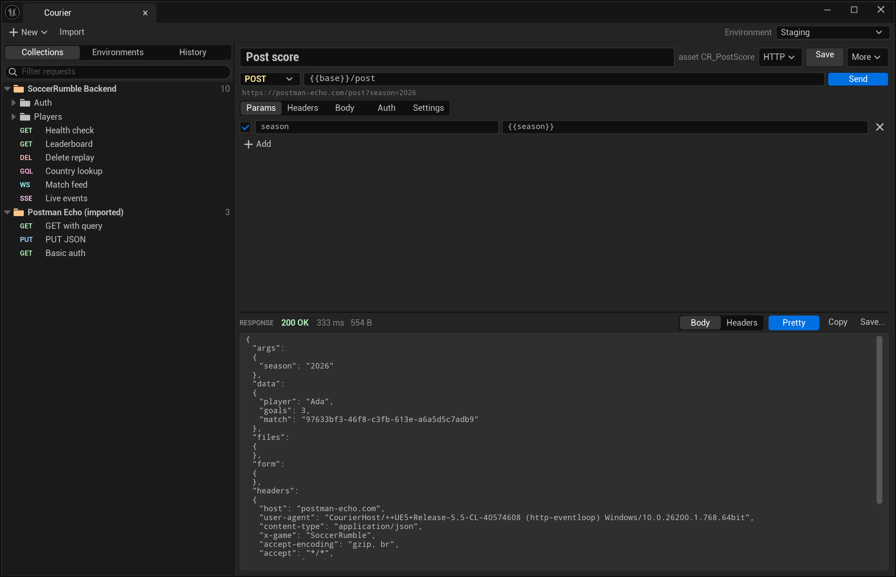
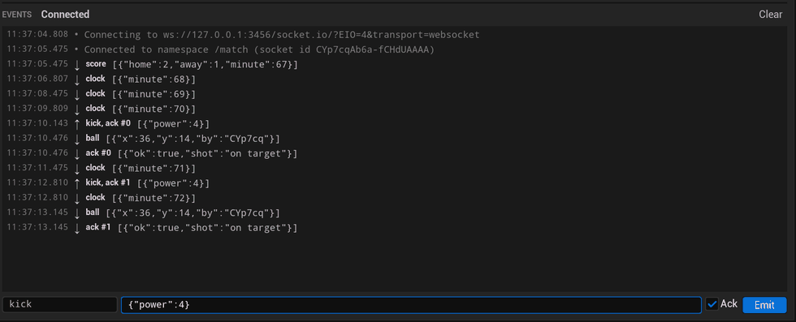
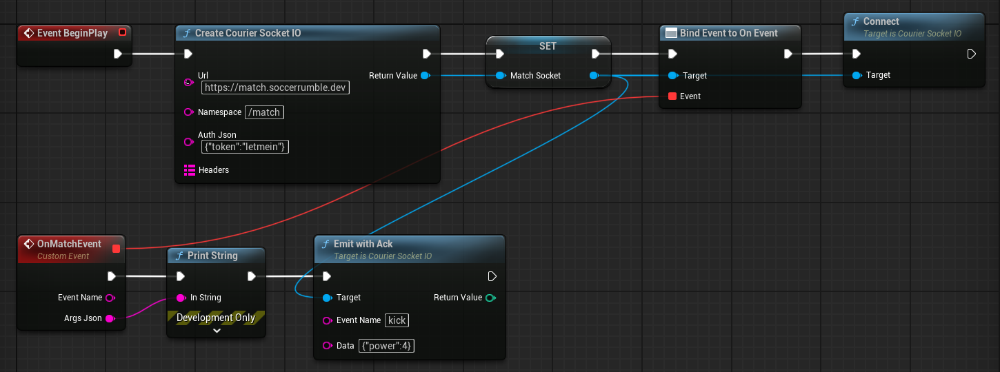
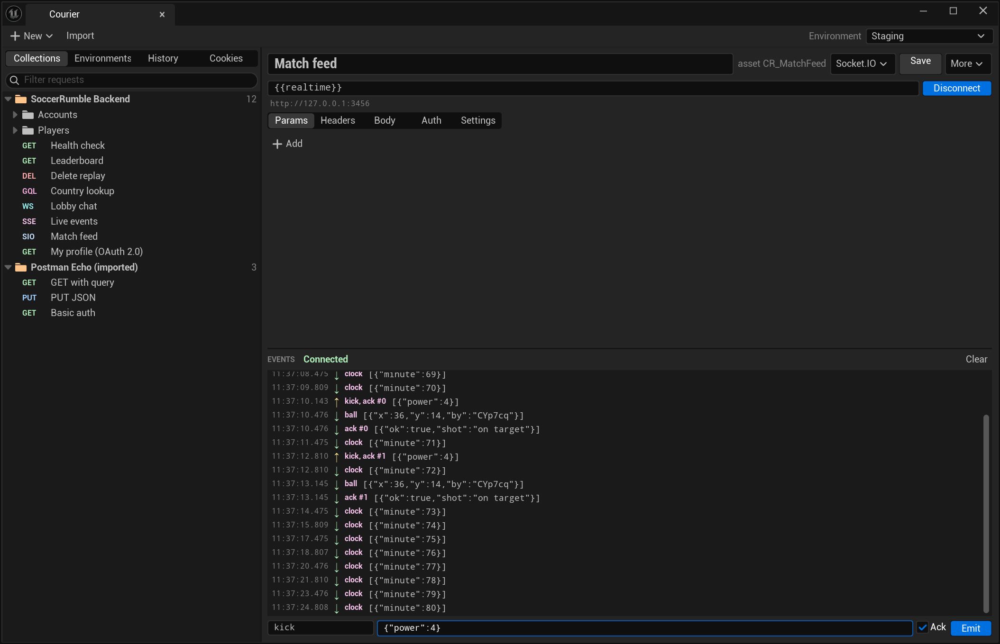
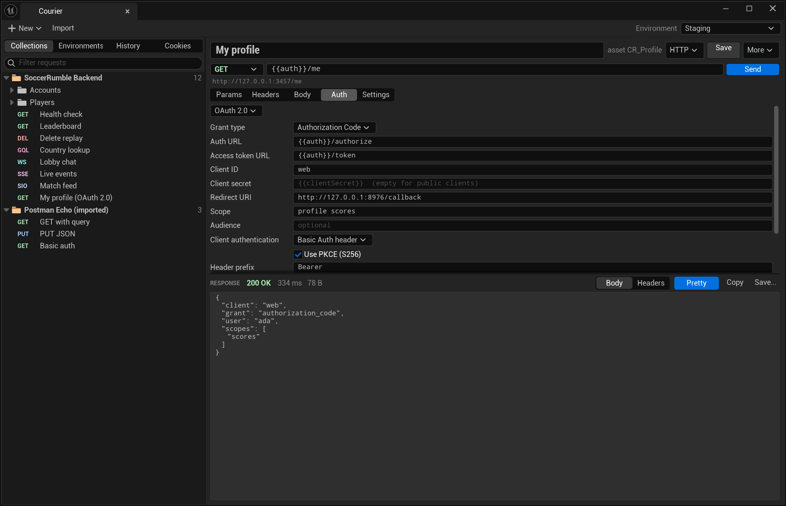
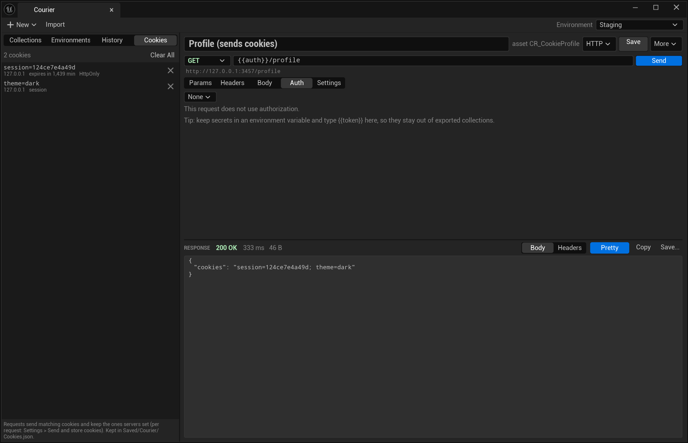
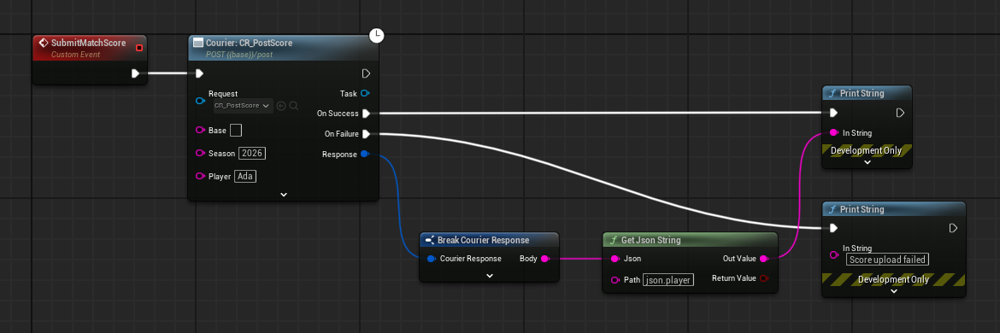
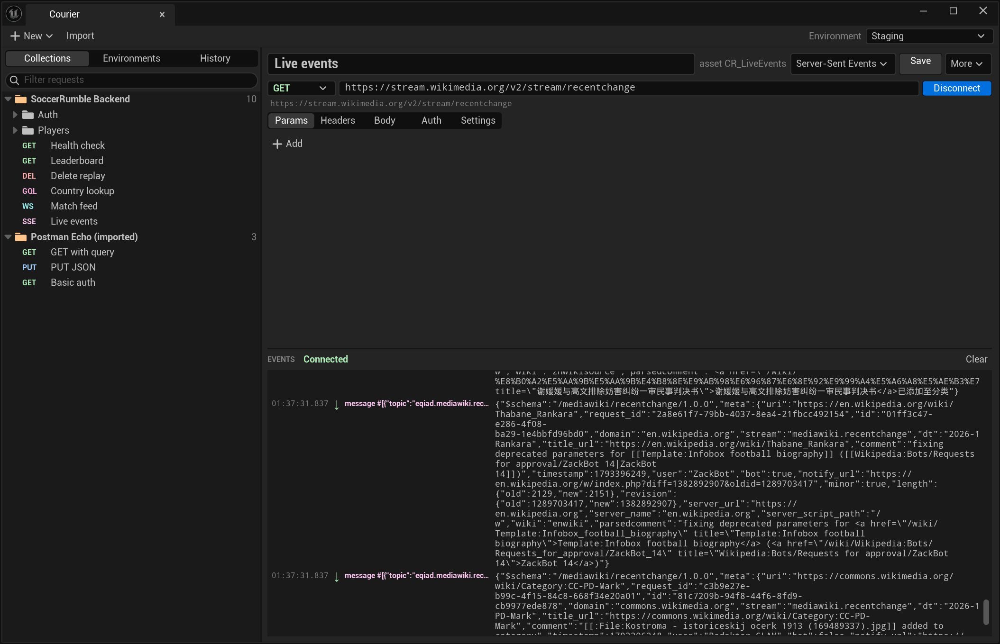
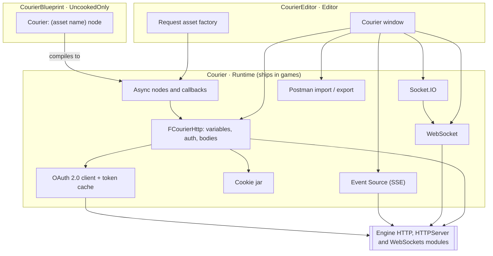
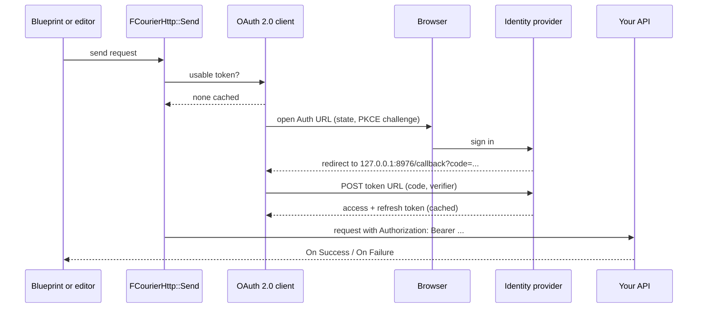

<p align="center">
  
</p>

<p align="center">
  
  
  
  
  
  
</p>

<p align="center">
  <b>Test your game's APIs without leaving the editor, then call the same requests from Blueprints with one node.</b><br>
  <a href="#quick-start">Quick start</a> ·
  <a href="#whats-included">What's included</a> ·
  <a href="#see-it-in-action">See it in action</a> ·
  <a href="docs/editor-guide.md">Editor guide</a> ·
  <a href="docs/blueprint-reference.md">Blueprint reference</a> ·
  <a href="docs/cpp-reference.md">C++ reference</a> ·
  <a href="docs/postman-compatibility.md">Postman compatibility</a>
</p>

---

<p align="center">
  
  <br><sub>The Courier window (<b>Tools &gt; Courier API Client</b>): a request from a collection, variables resolved from the Staging environment, real response from postman-echo.com.</sub>
</p>

## Why use Courier

Games talk to backends: login, matchmaking, leaderboards, store, telemetry, live events. Without Courier, testing those calls means switching to Postman, then writing the same request again in C++ or Blueprint, then debugging the two copies when they drift apart.

| Problem | How Courier helps |
|---|---|
| Alt-tabbing to Postman to check an endpoint | The client is an editor tab. Send, inspect status, time, size, headers and pretty JSON without leaving Unreal. |
| The request in Postman and the request in game code drift apart | Save a request as an asset. The **same asset** is what the editor sends and what the Blueprint node sends. |
| Wiring HTTP in Blueprint is verbose (build URL, headers, JSON, bind delegates) | One `Courier: <asset>` node with a pin per `{{variable}}` and **On Success** / **On Failure** outputs. |
| Your API sits behind OAuth 2.0 (Auth0, Keycloak, Cognito, Azure AD, your own) | Pick the grant, fill the URLs once. Courier gets the token, caches it, refreshes it and adds the header, in the editor and in game. |
| The backend logs you in with a session cookie | A cookie jar sends and keeps cookies per domain and path, like a browser. Inspect and clear them in the **Cookies** tab. |
| The realtime server speaks Socket.IO, not plain WebSocket | A Socket.IO v4 client with namespaces, auth payloads, named events and acknowledgements, as a console and as a Blueprint object. |
| Your team already has Postman collections | Import collections (v2.0, v2.1) and environments, OAuth 2.0 settings included; export them back. |
| Dev, staging and live use different hosts and keys | Environments and globals, switched from a combo box; `{{base}}` resolves everywhere. |

## What's included

Courier is one plugin with three modules. Nothing else to install: it uses the engine's own `HTTP`, `HTTPServer`, `WebSockets` and `Json` modules.

| Part | Module | What it is | Why it is useful |
|---|---|---|---|
| **Courier window** | `CourierEditor` (Editor) | A Postman-style tab: collections, folders, environments, globals, history, cookies, request editor, response viewer, stream console. | Explore and debug APIs inside the editor. [Guide](docs/editor-guide.md) |
| **Request assets** | `Courier` (Runtime) | `UCourierRequestAsset`: one request plus default variables, created from the window (**More > Save as Asset**) or the Content Browser. | A request becomes content: versioned, reviewed, referenced by Blueprints. |
| **`Courier: <asset>` node** | `CourierBlueprint` (UncookedOnly) | A custom K2 node listed once per request asset, with one input pin per `{{variable}}`. | The shortest path from "it works in the window" to "it works in game". |
| **Async request nodes** | `Courier` | `Send Courier Request`, `Courier GET`, `POST JSON`, `PUT JSON`, `PATCH JSON`, `DELETE`, `POST Form`, `Courier GraphQL`. | Ad-hoc calls from any graph without creating an asset. |
| **OAuth 2.0** | `Courier` | Client credentials, password and authorization code with PKCE grants; token cache, automatic refresh, browser sign-in with a local redirect listener; `Get Courier OAuth2 Token` async node. | Call protected APIs without writing token plumbing. [Details](docs/blueprint-reference.md#oauth-20) |
| **Cookie jar** | `Courier` | RFC 6265 cookie storage shared by every request (domain, path, expiry, Secure). Blueprint functions to read, set, clear, save and load. | Session-cookie backends work out of the box; logins survive a restart. |
| **WebSocket object** | `Courier` | `UCourierWebSocket`: Connect, Send Text, Send Binary, Close, plus six events. | Chat, match feeds, dev tools. |
| **Socket.IO object** | `Courier` | `UCourierSocketIO`: namespaces, auth payload, Emit, Emit With Ack, On Event, On Ack, ping/pong handled for you. | Talk to Node.js realtime servers without a JavaScript runtime. |
| **Event Source object** | `Courier` | `UCourierEventSource`: a WHATWG-compliant Server-Sent Events client. | Live ops feeds, progress streams, LLM token streams. |
| **JSON helpers** | `Courier` | `Get Json String / Number / Bool / Array Length / Keys` with paths like `data.users[0].name`, `Make Json Object`, `Pretty Print`, `Condense`. | Read responses in Blueprint without a struct per payload. |
| **Postman interop** | `Courier` | Import and export collections and environments, at edit time and at run time. | Reuse what your backend team already maintains. [Details](docs/postman-compatibility.md) |
| **C++ API** | `Courier` | `FCourierHttp`, `FCourierOAuth2Client`, `FCourierCookieJar`, `FCourierSocketIOConnection`, `FCourierSseConnection`, `FCourierPostman`. | Same features without UObjects. [Reference](docs/cpp-reference.md) |
| **Tests** | `Courier`, `CourierEditor` | 10 unit tests, 5 live tests, and a [local test server](Tools/TestServer) for OAuth 2.0 and Socket.IO. | Proof that it works, and a harness when you change it. |

## See it in action

### Socket.IO, live

<p align="center">
  
  <br><sub>Connected to the <code>/match</code> namespace with an auth token. The server pushes <code>score</code> and <code>clock</code>; <b>Emit</b> sends <code>kick</code> with <b>Ack</b> on, and the reply (<code>ack #0</code>) is matched to it.</sub>
</p>

<table>
  <tr>
    <td width="50%"></td>
    <td width="50%"></td>
  </tr>
  <tr>
    <td><sub><b>The same thing in Blueprint.</b> Create the client, keep it in a variable, bind <b>On Event</b>, connect. Every server event arrives with its name and its arguments as a JSON array, ready for <code>Get Json String</code> with paths like <code>[0].minute</code>.</sub></td>
    <td><sub><b>Socket.IO requests live in collections</b> like any other (badge <code>SIO</code>). Namespace and auth payload are in the request's Settings tab.</sub></td>
  </tr>
</table>

### OAuth 2.0 and cookies

<table>
  <tr>
    <td width="50%"></td>
    <td width="50%"></td>
  </tr>
  <tr>
    <td><sub><b>Authorization code with PKCE.</b> Send opened the browser, Courier caught the redirect on <code>127.0.0.1:8976</code>, swapped the code for a token and called <code>/me</code>. The token is cached with its refresh token for the next calls.</sub></td>
    <td><sub><b>Cookie jar.</b> <code>/login</code> set two cookies; the next request to <code>/profile</code> sent them back automatically. Delete one with its ✕ or clear them all.</sub></td>
  </tr>
</table>

### Request assets and streams

<table>
  <tr>
    <td width="50%"></td>
    <td width="50%"></td>
  </tr>
  <tr>
    <td><sub><b>A request asset as a node.</b> <code>Courier: CR_PostScore</code> has <b>Base</b>, <b>Season</b> and <b>Player</b> pins because the request uses <code>{{base}}</code>, <code>{{season}}</code> and <code>{{player}}</code>.</sub></td>
    <td><sub><b>Server-Sent Events.</b> Wikimedia's public recent-changes stream. WebSocket requests use the same console with a message box.</sub></td>
  </tr>
</table>

## Quick start

**Requirements:** Unreal Engine 5.5 and a C++ toolchain (the plugin ships as source). Tested on Windows 64-bit. A Blueprint-only project needs one C++ class added once so it can build plugins.

1. Clone into your project's `Plugins` folder:

   ```bash
   git clone https://github.com/ahmad-farrag/Courier-UE5.git Plugins/Courier
   ```

2. Enable it in your `.uproject` (or **Edit > Plugins > Networking > Courier**):

   ```json
   { "Name": "Courier", "Enabled": true }
   ```

3. Regenerate project files, build the editor target, and open the project.
4. Open **Tools > Courier API Client**, type `https://postman-echo.com/get?hello=world`, press **Ctrl+Enter**.

### Your first request as a Blueprint node

1. Build the request in the Courier window. Use `{{name}}` for anything that changes (`{{base}}/players/{{id}}`).
2. **More > Save as Asset**. Courier creates a `Courier Request` asset (default folder `/Game/Courier`).
3. In any Blueprint, right-click, type the asset name, pick **Courier: \<asset\>**.
4. Fill the variable pins, wire **On Success** and **On Failure**. Read the **Response** with `Break Courier Response` and the JSON helpers.

### A protected API (OAuth 2.0)

1. In the request's **Auth** tab choose **OAuth 2.0** and a grant type.
2. Fill the token URL, client id and secret (keep the secret in an environment: `{{clientSecret}}`). For **Authorization Code**, add the Auth URL and register `http://127.0.0.1:8976/callback` (or your own loopback port) with the provider.
3. Press **Send**. Courier gets a token first, then sends the request with `Authorization: Bearer <token>`. Later sends reuse the token and refresh it when it expires. The same works from the `Courier: <asset>` node and every async node.

### A Socket.IO server

1. **New > Socket.IO**, URL `https://your-server` (Courier adds `/socket.io/`), namespace and auth payload in **Settings**.
2. **Connect**, then type an event name and its data, and **Emit** (tick **Ack** to wait for the server's reply).
3. In Blueprint: `Create Courier Socket IO` (or `...From Request`), store it in a variable, bind **On Event**, call **Connect**.

### From C++

```cpp
#include "CourierHttp.h"

FCourierRequestSpec Spec;
Spec.Verb = ECourierVerb::Post;
Spec.Url = TEXT("{{base}}/scores");
Spec.BodyType = ECourierBodyType::Json;
Spec.Body = TEXT("{\"player\":\"{{player}}\",\"score\":42}");
Spec.Auth.Type = ECourierAuthType::OAuth2;
Spec.Auth.OAuth2.AccessTokenUrl = TEXT("{{base}}/oauth/token");
Spec.Auth.OAuth2.ClientId = TEXT("game-server");
Spec.Auth.OAuth2.ClientSecret = TEXT("{{clientSecret}}");

FCourierHttp::Send(Spec, Variables, [](const FCourierResponse& Response)
{
	UE_LOG(LogTemp, Log, TEXT("%d in %.0f ms: %s"), Response.StatusCode, Response.ElapsedSeconds * 1000.f, *Response.Body);
});
```

## Feature reference

<details open>
<summary><b>Requests</b></summary>

| | Supported |
|---|---|
| Methods | GET, POST, PUT, PATCH, DELETE, HEAD, OPTIONS, any custom verb |
| Body | none, JSON (with Beautify), raw with any content type, `x-www-form-urlencoded`, `multipart/form-data` (text and file fields), binary file, GraphQL (query + variables) |
| Auth | Bearer token, Basic, API key (header or query string), OAuth 2.0 |
| Variables | `{{name}}` in URL, params, headers, body, auth and form fields. Resolved recursively (up to 4 levels). |
| Dynamic variables | `{{$guid}}`, `{{$randomUUID}}`, `{{$timestamp}}`, `{{$isoTimestamp}}`, `{{$randomInt}}` |
| Precedence (editor) | globals, then collection variables, then the active environment; later wins, as in Postman |
| Precedence (asset nodes) | the asset's Default Variables, then the values passed to the node; passed values win |
| Cookies | Sent and stored per request (Settings > **Send and store cookies**, on by default) |
| Timeout | per request (default 30 s) |
| Copy as cURL | from the request's **More** menu or the tree's context menu |

</details>

<details>
<summary><b>OAuth 2.0</b></summary>

| | |
|---|---|
| Grants | Client Credentials, Password, Authorization Code (PKCE S256 on by default), Refresh Token (automatic) |
| Client authentication | Basic Auth header or in the request body; public clients (no secret) send `client_id` only |
| Browser sign-in | Opens the system browser at the Auth URL; Courier listens on the loopback Redirect URI (`http://127.0.0.1:<port>/<path>`), checks `state`, exchanges the code; times out after 5 minutes |
| Tokens | Cached per token URL, client, scope, audience and user; refreshed 30 s before expiry with the refresh token; JSON and form-encoded token replies (GitHub) are both read |
| Extras | `audience` parameter, header prefix, a fixed access token, **Get New Access Token** and **Clear Tokens** in the editor, `Get Courier OAuth2 Token` async node, `Clear Courier OAuth2 Tokens` |

</details>

<details>
<summary><b>Cookies</b></summary>

One jar shared by every Courier request in the process, following RFC 6265: host-only and `Domain` cookies, default and explicit paths, `Max-Age` over `Expires`, `Secure` only over https/wss, deletion by expiry, longest path first. The editor keeps it in `Saved/Courier/Cookies.json`; games call `Save Courier Cookies` / `Load Courier Cookies` when they want persistence.

</details>

<details>
<summary><b>Responses</b></summary>

`FCourierResponse` carries `bSuccess` (2xx), `bReceivedResponse`, `StatusCode`, `Body` (text), `Content` (bytes), `Headers` (map), `ContentType`, `ElapsedSeconds`, `SizeBytes`, `Error`, `Url` and `Verb`. On Failure fires for non-2xx statuses, network errors (DNS, TLS, refused, timeout), OAuth 2.0 token failures and cancellation.

</details>

<details>
<summary><b>Streaming</b></summary>

| | WebSocket | Socket.IO | Server-Sent Events |
|---|---|---|---|
| URLs | `ws://`, `wss://` | `http(s)://` or `ws(s)://`; `/socket.io/` added unless a path is given | `http://`, `https://` |
| Server versions | any | Socket.IO v3 and v4 (Engine.IO 4) | any `text/event-stream` |
| Send | text, binary | named events with any JSON arguments, optional acknowledgement | (receive only) |
| Receive | text; binary (fragments joined) | named events (arguments as a JSON array), acks, server-requested acks answered | `event`, `data`, `id`, `retry` |
| Extras | sub-protocols, headers | namespaces, CONNECT auth payload, ping/pong and ping timeout, headers | headers, any chunking and line ending |
| Events | Connected, Connection Error, Closed, Message, Binary Message, Message Sent | Connected (socket id), Connect Error, Disconnected (reason), Event, Ack | Open, Event, Closed |

</details>

<details>
<summary><b>Editor conveniences</b></summary>

Collections with nested folders, rename / duplicate / move / delete, a filter box, history of the last 200 requests, a cookie list, a live preview of the resolved URL, warnings for unresolved `{{variables}}`, **Ctrl+Enter** to send, **Ctrl+S** to save, console commands `Courier.Open` and `Courier.Send`. The workspace is stored per machine in `Saved/Courier/Workspace.json`; share collections by exporting them.

</details>

## Architecture



How a request with OAuth 2.0 (authorization code) goes out:



More in [docs/architecture.md](docs/architecture.md).

## Compared with Postman

| Feature | Courier |
|---|---|
| HTTP methods, params, headers, all common body types | Yes |
| Bearer, Basic, API key, OAuth 2.0 (client credentials, password, authorization code + PKCE, refresh) | Yes |
| Collections, folders, environments, globals, history, cookie jar | Yes |
| GraphQL, WebSocket, Socket.IO, Server-Sent Events | Yes |
| Postman collection v2.0 / v2.1 and environment import / export | Yes, OAuth 2.0 settings included |
| Code generation | cURL; plus the Blueprint node and C++ API |
| Pre-request and test scripts | No (ignored on import) |
| OAuth 1.0, Digest, AWS Signature, Hawk, NTLM; OAuth 2.0 implicit and device code | No (implicit imports as authorization code with PKCE) |
| Mock servers, monitors, gRPC, MQTT, Socket.IO binary attachments | No |

## Known limitations

* **Cookies set on a redirect** (3xx) are not seen: the engine's HTTP layer follows redirects itself and drops their headers. Cookies set on the final response are stored normally.
* **Socket.IO** speaks Engine.IO 4 over WebSocket only (no long-polling fallback) and skips binary attachments with a log warning.
* **Python, UE 5.5:** binding a Python callable to a delegate with a **struct** parameter (HTTP response, SSE event, OAuth token) crashes inside the engine's Python bridge (`PyGenUtil::InvokePythonCallableFromUnrealFunctionThunk`). Delegates with string and int parameters work, which covers every WebSocket and Socket.IO event. Blueprint and C++ are not affected.

## Tests

Run from **Tools > Session Frontend > Automation**, or headless:

```bash
UnrealEditor-Cmd.exe YourProject.uproject -ExecCmds="Automation RunTests Courier; Quit" -unattended -nullrhi
```

| Test | Covers |
|---|---|
| `Courier.Variables` | `{{var}}` resolution, nested variables, unknown and unclosed `{{` left as typed, `$guid` / `$timestamp`, variable name discovery |
| `Courier.Prepare` | Verb and URL, Basic auth, form encoding with non-ASCII text, GraphQL bodies, API key in the query, multipart boundaries, missing upload file rejected |
| `Courier.Curl` | Verb, headers, content type and body quoting in the cURL export |
| `Courier.Json` | Paths, array lengths, missing paths, objects as JSON, top-level arrays, keys, invalid JSON, `Make Json Object` |
| `Courier.Postman` | v2.1 / v2.0 import (folders, disabled rows, auth inheritance, `noauth`, multipart files, GraphQL), round trip, environments |
| `Courier.SseParser` | Comments, named events, multi-line data, `id`, `retry`; fed one byte at a time with CRLF, LF and CR |
| `Courier.Cookies` | Set-Cookie parsing (Domain, Path, Max-Age, Expires, Secure, quotes), foreign-domain and insecure rejection, deletion, domain and path matching, ordering, engine-merged headers, save and load |
| `Courier.OAuth2` | SHA-256 and RFC 7636 PKCE vectors, token request bodies (header and body client auth), JSON and form token replies, error replies, authorize URL, loopback redirect parsing, header injection, Postman round trip |
| `Courier.SocketIO` | Engine.IO URL building, event / ack / connect / disconnect encoding, decoding with namespaces, ack ids and binary headers, argument conversion |
| `Courier.Editor.RequestNode` | A Blueprint with a `Courier: <asset>` node compiles and keeps pins across a reconstruct |
| `Courier.Live.Http`, `.ServerSentEvents`, `.Cookies` | Real requests to postman-echo.com and stream.wikimedia.org |
| `Courier.Live.OAuth2`, `.SocketIO` | Client credentials, password grant, wrong secret, automatic refresh; Socket.IO connect, refused namespace, emit, ack, disconnect. Run against [Tools/TestServer](Tools/TestServer) with `COURIER_TEST_OAUTH_URL=http://127.0.0.1:3457` and `COURIER_TEST_SOCKETIO_URL=http://127.0.0.1:3456` |

The live tests are in the Stress filter: `Automation SetFilter Stress; RunTests Courier.Live`.

## Repository layout

```text
Courier.uplugin
Config/DefaultCourier.ini        core redirect for the node's module move
Resources/Icon128.png
Source/
  Courier/                       runtime: HTTP, OAuth 2.0, cookies, WebSocket, Socket.IO, SSE, Postman, JSON, async nodes
  CourierBlueprint/              the 'Courier: <asset>' K2 node
  CourierEditor/                 the editor window, request asset factory, tests
Tools/TestServer/                Node.js Socket.IO server and mock OAuth 2.0 provider for live tests
docs/                            guides and references
```

## Roadmap

Ideas, not promises: response assertions as Blueprint nodes, OAuth 2.0 device code grant, Socket.IO binary attachments, C++ code generation from a request, and testing on Mac and Linux.

## Author

Built by [Ahmed Farrag](https://github.com/ahmad-farrag).

## License

MIT. See [LICENSE](LICENSE).
