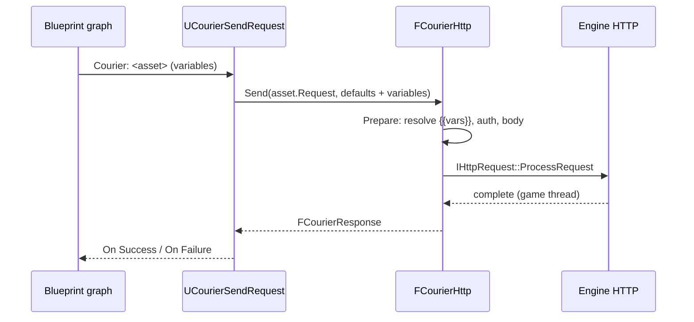

# Architecture

## Modules

| Module | Type | Loaded in | Contents |
|---|---|---|---|
| `Courier` | Runtime | Editor and packaged games | Types, `FCourierHttp`, async nodes (`UCourierSendRequest`), OAuth 2.0 (`FCourierOAuth2Client`, `UCourierOAuth2Task`), the cookie jar, `UCourierWebSocket`, Socket.IO (`FCourierSocketIOConnection`, `UCourierSocketIO`), `UCourierEventSource` and the SSE parser, `FCourierPostman`, `UCourierLibrary`, `UCourierRequestAsset` |
| `CourierBlueprint` | UncookedOnly | Editor and commandlets, never in cooked games | `UK2Node_CourierRequest`, the `Courier: <asset>` node |
| `CourierEditor` | Editor | Editor | The Courier window, workspace storage, request asset factory and asset definition, menu entries, console commands, editor and live tests |

The Blueprint node lives in an UncookedOnly module because K2 nodes are only needed to compile Blueprints. A node class from an Editor module triggers UE 5.5's "is from an Editor Only module, but is placed in a runtime blueprint" warning; UncookedOnly is the type Epic uses for its own node modules. `Config/DefaultCourier.ini` redirects the class from its earlier home in `CourierEditor`.

Engine dependencies: `HTTP`, `HTTPServer` (the OAuth 2.0 redirect listener), `WebSockets`, `Json`, `JsonUtilities` at run time; `BlueprintGraph`, `KismetCompiler`, `UnrealEd`, Slate and tool-menu modules in the editor.

## How a request flows

1. The K2 node expands at compile time into `UCourierLibrary::SendCourierRequestAsset` plus one `AddCourierVariable` call per variable pin, chained into the `Variables` map.
2. `SendCourierRequestAsset` merges the asset's Default Variables with the passed map (passed values win) and creates a `UCourierSendRequest`.
3. The task registers with the game instance so it is not garbage collected mid-flight; outside a game (editor utilities, Python) it roots itself until it finishes.
4. `FCourierHttp::Prepare` resolves variables (up to four nested passes), adds auth headers, encodes the body and sets the content type.
5. The response is wrapped in `FCourierResponse` and delivered once, on the game thread.

## OAuth 2.0

`FCourierHttp::Send` checks for a usable token before it prepares a request with OAuth 2.0 auth. Without one it calls `FCourierOAuth2Client::GetToken`, which:

1. returns a cached token that is still valid for at least 30 seconds;
2. otherwise posts `grant_type=refresh_token` when the cached token has a refresh token;
3. otherwise runs the grant: a form POST for client credentials and password; for authorization code, binds a route on the loopback redirect port with the engine's `HTTPServer` module, opens the browser at the authorization URL (with `state` and an S256 PKCE challenge), and exchanges the returned code.

Calls for the same settings while a token request is running wait for that request instead of starting another, so ten Blueprint nodes firing at once still open the browser once. SHA-256 for PKCE is implemented in the plugin (checked against the FIPS and RFC 7636 test vectors) so there is no OpenSSL dependency.

## Cookies

`Prepare` adds a `Cookie` header from `FCourierCookieJar::Get()` for the final URL, and `SendPrepared` stores the response's `Set-Cookie` headers. The engine joins repeated headers with ", ", which collides with the commas in `Expires` dates; `SplitMergedSetCookie` splits only where a new `name=` begins.

## Socket.IO

`FCourierSocketIOConnection` opens an engine WebSocket to `/socket.io/?EIO=4&transport=websocket`, waits for the Engine.IO open packet (`0{...}`, which carries the ping interval and timeout), joins the namespace with a CONNECT packet (`40/match,{auth}`), answers server pings (`2` with `3`), and turns `42[...]` events and `43[...]` acks into callbacks. A core ticker closes the connection when no traffic arrives within the ping interval plus timeout.

## Server-Sent Events

The engine's HTTP module delivers a streaming body through `SetResponseBodyReceiveStream`. Courier passes a small `FArchive` that feeds bytes into `FCourierSseParser` on the HTTP thread; complete events are posted to the game thread. The parser follows the WHATWG rules: `event`, `data` (joined with newlines), `id` (kept across events), `retry`, comments, and CR, LF or CRLF line endings even when a chunk splits a CRLF. The activity timeout is raised so idle streams are not cut after the default 30 seconds.

## The editor window

`SCourierWindow` is a Slate compound widget in a nomad tab. It edits a working copy of a request and writes it back to its collection or asset on Save. `FCourierWorkspace` is a singleton that loads and saves `Saved/Courier/Workspace.json` with `FJsonObjectConverter` and broadcasts `OnChanged` so the sidebar refreshes.
