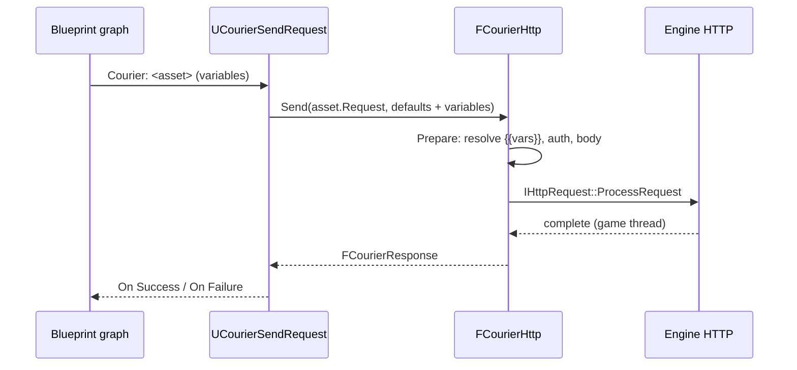

# Architecture

## Modules

| Module | Type | Loaded in | Contents |
|---|---|---|---|
| `Courier` | Runtime | Editor and packaged games | Types, `FCourierHttp`, async nodes (`UCourierSendRequest`), `UCourierWebSocket`, `UCourierEventSource` and the SSE parser, `FCourierPostman`, `UCourierLibrary` (JSON and helpers), `UCourierRequestAsset` |
| `CourierBlueprint` | UncookedOnly | Editor and commandlets, never in cooked games | `UK2Node_CourierRequest`, the `Courier: <asset>` node |
| `CourierEditor` | Editor | Editor | The Courier window, workspace storage, request asset factory and asset definition, menu entries, console commands, editor and live tests |

The Blueprint node lives in an UncookedOnly module because K2 nodes are only needed to compile Blueprints. A node class from an Editor module triggers UE 5.5's "is from an Editor Only module, but is placed in a runtime blueprint" warning; UncookedOnly is the type Epic uses for its own node modules. `Config/DefaultCourier.ini` redirects the class from its earlier home in `CourierEditor`.

Engine dependencies: `HTTP`, `WebSockets`, `Json`, `JsonUtilities` at run time; `BlueprintGraph`, `KismetCompiler`, `UnrealEd`, Slate and tool-menu modules in the editor.

## How a request flows

1. The K2 node expands at compile time into `UCourierLibrary::SendCourierRequestAsset` plus one `AddCourierVariable` call per variable pin, chained into the `Variables` map.
2. `SendCourierRequestAsset` merges the asset's Default Variables with the passed map (passed values win) and creates a `UCourierSendRequest`.
3. The task registers with the game instance so it is not garbage collected mid-flight; outside a game (editor utilities, Python) it roots itself until it finishes.
4. `FCourierHttp::Prepare` resolves variables (up to four nested passes), adds auth headers, encodes the body and sets the content type.
5. The response is wrapped in `FCourierResponse` and delivered once, on the game thread.

## Server-Sent Events

The engine's HTTP module delivers a streaming body through `SetResponseBodyReceiveStream`. Courier passes a small `FArchive` that feeds bytes into `FCourierSseParser` on the HTTP thread; complete events are posted to the game thread. The parser follows the WHATWG rules: `event`, `data` (joined with newlines), `id` (kept across events), `retry`, comments, and CR, LF or CRLF line endings even when a chunk splits a CRLF. The activity timeout is raised so idle streams are not cut after the default 30 seconds.

## The editor window

`SCourierWindow` is a Slate compound widget in a nomad tab. It edits a working copy of a request and writes it back to its collection or asset on Save. `FCourierWorkspace` is a singleton that loads and saves `Saved/Courier/Workspace.json` with `FJsonObjectConverter` and broadcasts `OnChanged` so the sidebar refreshes.
