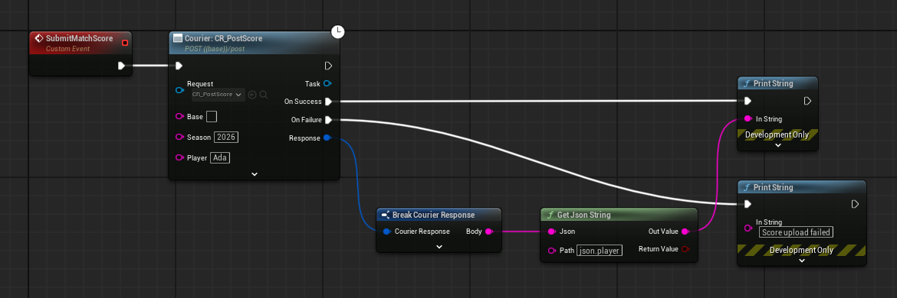

# Blueprint reference

Everything below is in the **Courier** category of the Blueprint action menu. All callbacks run on the game thread.

## The `Courier: <asset>` node

One entry per Courier Request asset in the project, titled with the asset name. The subtitle shows the method and URL.

| Pin | Direction | Meaning |
|---|---|---|
| Exec | in | Sends the request |
| **Request** | in | The asset. Change it and the variable pins rebuild |
| One string pin per `{{variable}}` | in | Named after the variable (`{{player}}` gives **Player**). Empty pins fall back to the asset's Default Variables |
| **Variables** (advanced) | in | Map of extra variables; useful for names the request builds dynamically |
| Then (top exec out) | out | Fires immediately after sending |
| **On Success** | out | Fires once with a 2xx response |
| **On Failure** | out | Fires once for any other status, no response (DNS, TLS, refused, timeout) or Cancel |
| **Response** | out | `Courier Response`, valid when On Success or On Failure fires |
| **Task** | out | The `Courier Send Request` object; call **Cancel** or **Is In Flight** on it |

Variable pins follow the asset: add `{{token}}` to a header and every node using the asset gains a **Token** pin on the next refresh, keeping the values already typed into existing pins. Dynamic variables (`$guid` and friends) never get pins.

The node is compiled into plain calls to `Send Courier Request Asset` and `Add Courier Variable`, so it costs nothing extra at run time.

## Async request nodes

Latent nodes with **On Success**, **On Failure**, **Response** and **Task** like the asset node. They can be used in event graphs and macros (not in functions; use the callback versions there).

| Node | Inputs |
|---|---|
| **Send Courier Request** | `Request` (Courier Request Spec), `Variables` (map) |
| **Courier GET** | `Url`, `Headers` |
| **Courier POST JSON** | `Url`, `Json`, `Headers` |
| **Courier PUT JSON** | `Url`, `Json`, `Headers` |
| **Courier PATCH JSON** | `Url`, `Json`, `Headers` |
| **Courier DELETE** | `Url`, `Headers` |
| **Courier POST Form** | `Url`, `Fields` (map, sent URL-encoded), `Headers` |
| **Courier GraphQL** | `Url`, `Query`, `VariablesJson`, `Headers` |

`Courier Send Request` (the Task) also has **Send**, **Cancel** and **Is In Flight**.

## Callback functions

For functions, Blueprint function libraries and anywhere a latent node is not allowed. Each returns the Task.

| Function | Inputs |
|---|---|
| **Send Courier Request With Callback** | `Request`, `Variables`, `On Complete` (delegate taking a Courier Response) |
| **Send Courier Request Asset With Callback** | `Request Asset`, `Variables`, `On Complete` |
| **Create Courier Request** | `Request`, `Variables`; returns the Task without sending. Bind events, then call **Send** |

`On Complete` fires exactly once. Check `Success` on the response to branch.

## Courier Response

| Field | Type | Notes |
|---|---|---|
| Success | bool | Status 200-299 |
| Received Response | bool | False for network errors and cancellation |
| Status Code | int | 0 when nothing was received |
| Body | string | Text of the body (UTF-8) |
| Content | byte array | Raw bytes, for images and other binary data |
| Headers | map | Response headers |
| Content Type | string | |
| Elapsed Seconds | float | From send to completion |
| Size Bytes | int64 | Body size |
| Error | string | Human-readable reason when not successful |
| Url, Verb | string | What was actually sent, after variables |

**Get Courier Response Header** looks a header up case-insensitively.

## WebSocket

**Create Courier WebSocket** (`Url`, `Protocols`, `Headers`) or **Create Courier WebSocket From Request** (`Request`, `Variables`) return a `Courier WebSocket`. Store it in a variable: when nothing references it, it is garbage collected and the connection closes.

| Function | |
|---|---|
| Connect | Opens the connection |
| Send Text / Send Binary | Returns false when not connected |
| Close | `Status Code` (default 1000), `Reason` |
| Is Connected, Get Url | |

| Event | Parameters |
|---|---|
| On Connected | |
| On Connection Error | Error |
| On Closed | Status Code, Reason, Was Clean |
| On Message | Message (text) |
| On Binary Message | Data (bytes; fragments joined first) |
| On Message Sent | Message |

## Socket.IO

**Create Courier Socket IO** (`Url`, `Namespace`, `Auth Json`, `Headers`) or **Create Courier Socket IO From Request** (`Request`, `Variables`; URL, headers, auth, namespace and auth payload come from the request) return a `Courier Socket IO`. Keep it in a variable.

`Url` is the server address (`https://example.com`); Courier connects to `wss://example.com/socket.io/?EIO=4&transport=websocket`. Give a path (`https://example.com/realtime/`) when the server uses a custom one. Works with Socket.IO v3 and v4 servers.

| Function | |
|---|---|
| Connect, Disconnect | |
| Emit | `Event Name`, `Data`: any JSON value is sent as one argument as is (`{"x":1}`, `42`, `true`); other text is sent as a string; empty sends no argument. False when not connected |
| Emit With Ack | Same, and asks the server to acknowledge. Returns the ack id (-1 when not connected); **On Ack** fires with it |
| Emit Args | `Args Json Array`: several arguments at once, e.g. `[1, "two", {"three": 3}]` |
| Is Connected, Get Socket Id | |

| Event | Parameters |
|---|---|
| On Connected | Socket Id |
| On Connect Error | Message (the server's middleware error, e.g. "unauthorized", or a WebSocket error) |
| On Disconnected | Reason (`io client disconnect`, `io server disconnect`, `transport close (...)`, `ping timeout`) |
| On Event | Event Name, Args Json (a JSON array of the event's arguments: read them with `Get Json String` and paths like `[0].score`) |
| On Ack | Ack Id, Args Json |

Every parameter is a string or an int, so these events also work from Python. When the server asks for an acknowledgement of one of its events, Courier answers with no arguments.

## OAuth 2.0

Set a request's `Auth.Type` to **OAuth 2.0** and fill `Auth.OAuth2` (`Courier OAuth2`). Every send then makes sure a token exists: it uses the cached one, refreshes it with the refresh token when it is about to expire (30 seconds early), or runs the grant. On Failure fires with `Error` starting "OAuth 2.0:" when no token can be had.

| Field | |
|---|---|
| Grant Type | Client Credentials, Password Credentials, Authorization Code |
| Access Token Url, Auth Url | Auth Url is used by Authorization Code only |
| Client Id, Client Secret | Leave the secret empty for public clients |
| Scope, Audience | Space separated scopes; audience is sent when set |
| Username, Password | Password grant only |
| Redirect Uri | `http://127.0.0.1:<port>/<path>` or `http://localhost:...`; Courier listens there while the browser sign-in runs (5 minute limit) |
| Use Pkce | S256 code challenge; on by default |
| Client Authentication | Basic Auth header (default) or in the request body |
| Header Prefix | Word before the token, `Bearer` by default |
| Access Token | A token to use as is; empty lets Courier manage it |

| Node / function | |
|---|---|
| **Get Courier OAuth2 Token** (async) | `Settings`, `Variables`, `Force New`. **On Success** / **On Failure** with a `Courier OAuth2 Token`: `Access Token`, `Token Type`, `Refresh Token`, `Id Token`, `Scope`, `Expires At` (UTC), `Error`, `Raw Response` |
| Get Cached Courier OAuth2 Token | The cached token for these settings, valid or expired |
| Clear Courier OAuth2 Tokens | Forget every cached token (sign-out) |

Tokens are cached in memory for the running process. Authorization Code opens the system browser, so use it in the editor and on desktop; servers and headless games use Client Credentials.

## Cookies

Every request sends matching cookies and stores the ones the server sets, unless its `Use Cookie Jar` is off. The jar is shared by the whole process.

| Function | |
|---|---|
| Get Courier Cookies | Cookies that would be sent to `Url`; all cookies when `Url` is empty |
| Get Courier Cookie Header | The `Cookie` header value for `Url` |
| Set Courier Cookie | Add or replace a `Courier Cookie` (`Name`, `Value`, `Domain`, `Path`, `Expires`, `Secure`, `Http Only`, `Host Only`) |
| Remove Courier Cookies | By domain, or one cookie by domain and name |
| Clear Courier Cookies | |
| Save Courier Cookies, Load Courier Cookies | To and from a JSON file, for example `Saved/Cookies.json`, to keep a session across launches |

## Server-Sent Events

**Create Courier Event Source** (`Url`, `Headers`) or **Create Courier Event Source From Request** return a `Courier Event Source`. Keep it in a variable, as with WebSockets.

| Function | |
|---|---|
| Open | Starts the stream; returns false if the request cannot be built |
| Close | |
| Is Open | |

| Event | Parameters |
|---|---|
| On Open | Status Code |
| On Event | `Courier Sse Event`: Event Name (default `message`), Data, Id, Retry (-1 when not sent) |
| On Closed | Error (empty when you closed it), Status Code |

## JSON helpers

Paths use dots for fields and brackets for array indexes: `data.users[0].name`, `[2].id` for a top-level array, empty for the root.

| Function | Returns |
|---|---|
| Get Json String | bool found, `Out Value`. Strings as-is, numbers and bools as text, objects and arrays as JSON |
| Get Json Number / Get Json Bool | bool found, value |
| Get Json Array Length | -1 when the path is missing or not an array |
| Get Json Keys | Field names of the object at the path |
| Make Json Object | From a string map; with `Parse Values` on, `42`, `true` and `{...}` become typed values |
| Is Valid Json, Pretty Print Json, Condense Json | |

## Requests and Postman

| Function | |
|---|---|
| Resolve Courier Variables | Fills `{{name}}` in any text |
| Get Courier Request Variable Names | Variables a spec uses, in order |
| Courier Request To Curl | |
| Find Courier Request | By name and folder in a collection |
| Import / Export Postman Collection | JSON text to and from `Courier Collection` |
| Import / Export Postman Environment | JSON text to and from `Courier Environment` |

Import at run time lets a game read request definitions from a downloaded file, for example a live-ops config.

## Courier Request Spec

The struct behind every request: `Name`, `Folder`, `Description`, `Protocol` (Http, WebSocket, ServerSentEvents, SocketIO), `Verb`, `Custom Verb`, `Url`, `Query Params`, `Headers`, `Body Type`, `Body`, `Raw Content Type`, `Form Fields`, `GraphQL Query`, `GraphQL Variables`, `Auth` (including `OAuth2`), `Timeout Seconds`, `Web Socket Protocols`, `Use Cookie Jar`, `Socket IO Namespace`, `Socket IO Auth`. Key / value rows have an `Enabled` flag; disabled rows are not sent.
