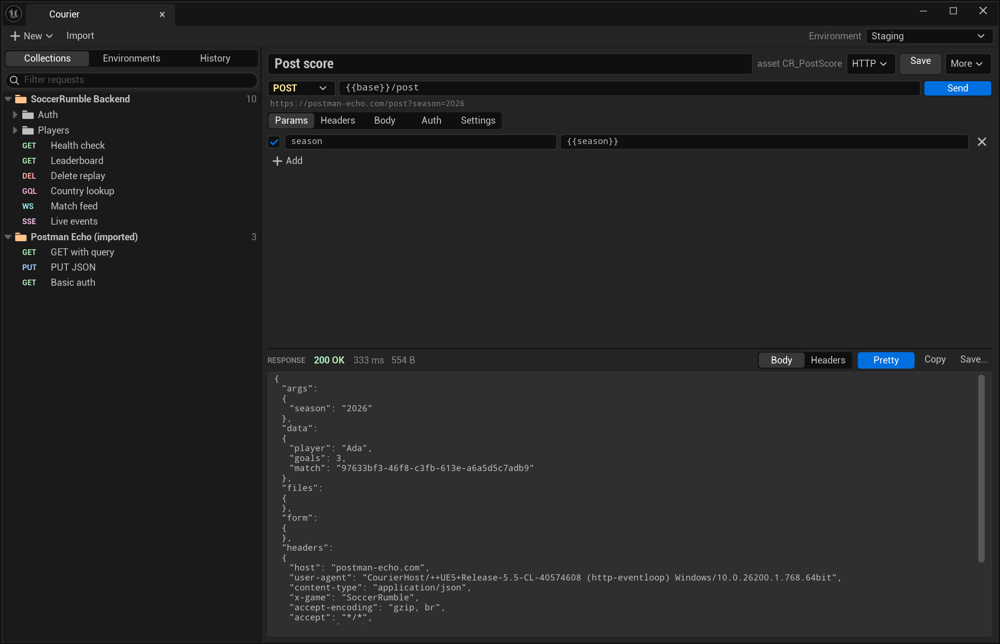
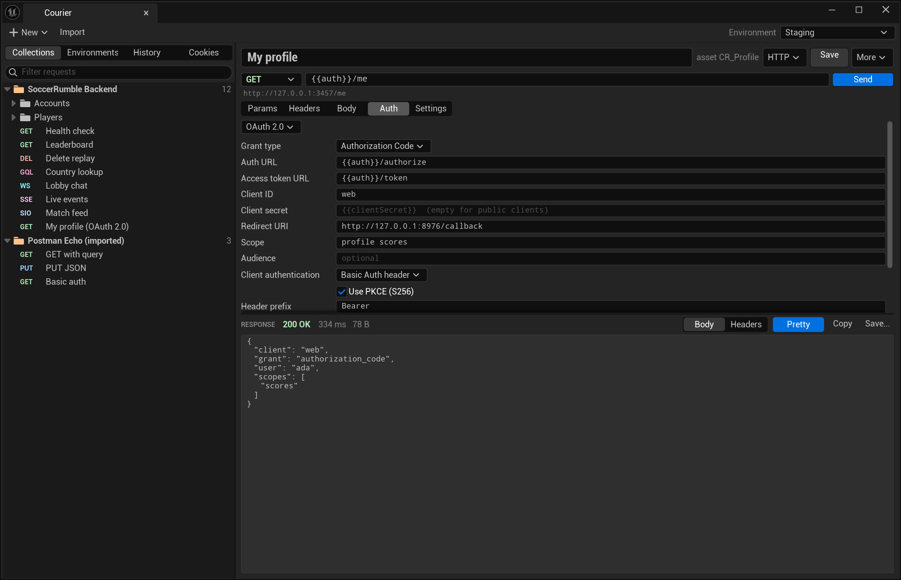
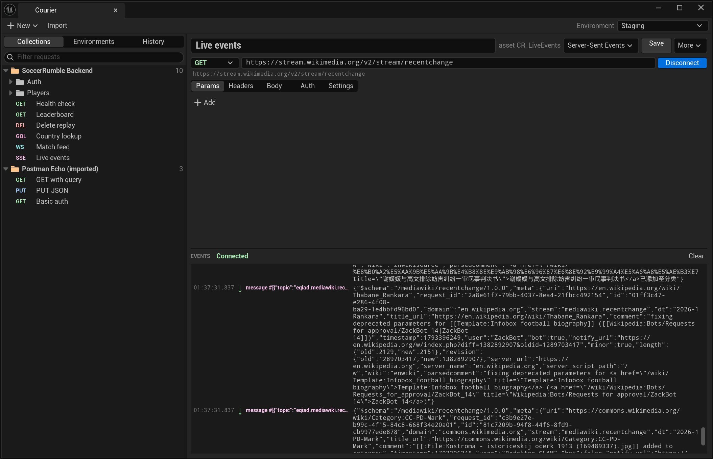
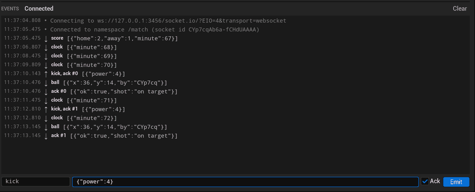
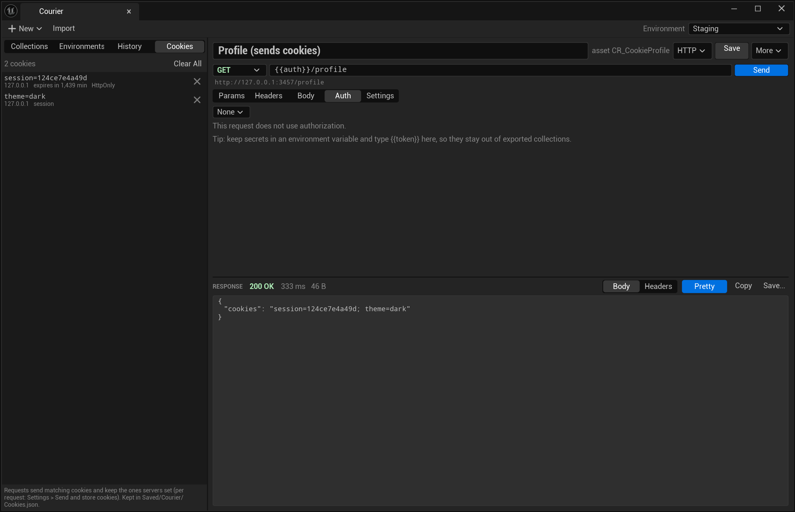

# Editor guide

The Courier window is a dockable editor tab. Open it from **Tools > Courier API Client**, with the console command `Courier.Open`, or by double-clicking a Courier Request asset.

## Layout

| Area | What it holds |
|---|---|
| Toolbar | **New** (HTTP, GraphQL, WebSocket, Server-Sent Events, Socket.IO, Collection), **Import**, and the **Environment** combo (with **Manage environments...**) |
| Sidebar | Four tabs: **Collections**, **Environments**, **History**, **Cookies** |
| Request editor | Name, protocol, **Save**, **More**; method and URL with **Send** / **Connect**; the resolved URL preview; tabs **Params**, **Headers**, **Body**, **Auth**, **Settings** |
| Bottom pane | **Response** for HTTP and GraphQL, or the **Events** / **Messages** console for streams |

## Sending a request

1. **New > HTTP Request** (or pick one from a collection).
2. Choose the method. **Custom...** accepts any verb.
3. Type the URL. Query parameters typed in the URL and rows in **Params** are combined; the grey line under the URL shows exactly what will be sent, with variables filled in.
4. Press **Send** or **Ctrl+Enter**. While a request is in flight the button reads **Sending...**; pressing it again cancels.

If a `{{variable}}` has no value, the editor shows **not set: name** under the URL so you see it before sending.

## Body tab

| Type | Notes |
|---|---|
| None | No body |
| JSON | Sent as `application/json`. **Beautify** re-indents it; `{{variables}}` inside strings are fine |
| Raw | Any text with a **Content-Type** you choose |
| x-www-form-urlencoded | Key / value rows, URL-encoded as UTF-8 |
| form-data | Text and file rows; files are read from disk when you send |
| Binary | Path of a file whose bytes are the body |
| GraphQL | **QUERY** plus **GRAPHQL VARIABLES (JSON)**; sent as `{"query": ..., "variables": ...}` |

## Auth tab

Bearer token, Basic (username and password), API key (key and value, sent as a header or, with **Send in the query string instead of a header**, as a query parameter), or OAuth 2.0. Every field accepts variables, so secrets normally live in an environment: `{{clientSecret}}`.

### OAuth 2.0

1. Pick the **Grant type**: Client Credentials (machine to machine), Password Credentials, or Authorization Code (a user signs in through the browser).
2. Fill **Access token URL**, **Client ID** and **Client secret**; for Authorization Code also **Auth URL** and **Redirect URI**. The redirect URI must be a loopback address (`http://127.0.0.1:8976/callback` by default) registered with the provider: Courier listens on that port during sign-in.
3. Optional: **Scope**, **Audience**, **Client authentication** (Basic header or body), **Use PKCE**, **Header prefix**, or a fixed **Access token**.
4. Press **Send**. Without a token, Courier gets one first (Authorization Code opens your browser; the page says "Signed in" when Courier has the code). **Get New Access Token** does the same without sending the request; **Clear Tokens** forgets every cached token.

The status line shows the cached token (shortened), how long it is valid, and whether a refresh token is kept. Expired tokens are refreshed automatically on the next send.

## Settings tab

**Timeout** in seconds (0 uses the engine default), **Send and store cookies**, and per protocol: **Sub-protocols** for WebSocket, **Namespace** and **Auth payload** (JSON sent with the Socket.IO CONNECT packet; the server reads it as `socket.handshake.auth`) for Socket.IO.

## Response pane

Status (coloured by class), time in milliseconds and size. **Body** shows the text; **Pretty** pretty-prints JSON. **Headers** lists response headers. **Copy** puts the body on the clipboard; **Save...** writes the raw bytes to a file, which is how you keep images or other binary responses.

## WebSocket and Server-Sent Events

Pick the protocol from the combo next to the name, or create the request from **New**. **Connect** opens the stream; the same button then reads **Disconnect**.

* Each line has a timestamp and a direction marker: ↑ sent, ↓ received, • system, ! error.
* SSE lines are tagged with the event name and id. Long ids are shortened in the list; hover for the full value.
* WebSocket requests get a message box under the log. **Ctrl+Enter** in the box sends it, and `{{variables}}` in the message are filled.
* Binary WebSocket messages are shown as hex. **Clear** empties the log.

## Socket.IO

Create a request with **New > Socket.IO** (badge `SIO`). The URL is the server address; Courier adds `/socket.io/?EIO=4&transport=websocket`. Set the namespace and auth payload in **Settings**, then **Connect**.

* The log shows the connection, then every event: the event name in pink, its arguments as a JSON array.
* To emit, type the event name in the small box and the data in the large one (JSON is sent as is, other text as a string), then **Emit** or **Ctrl+Enter**. Tick **Ack** to request an acknowledgement; the reply appears as `ack #<id>`.
* A refused namespace shows the server's error ("Connect error: unauthorized ..."). **Disconnect** sends a proper Socket.IO disconnect.

## Cookies

The **Cookies** tab lists every cookie in the jar with its domain (a leading dot means subdomains too), path, expiry and flags. Delete one with its ✕, or **Clear All**. Requests send matching cookies and store new ones unless **Send and store cookies** is off in their Settings. The jar is saved in `Saved/Courier/Cookies.json`, so a login survives an editor restart.

## Collections

Collections hold requests and folders (folders can nest: `Users/Admin`). Right-click in the tree for:

| On | Commands |
|---|---|
| Collection | New HTTP Request, New WebSocket, New Server-Sent Events, New Socket.IO, New Folder, Rename, Export to Postman..., Delete |
| Folder | the same New commands, Rename, Delete |
| Request | Duplicate, Move to Folder..., Rename, Copy as cURL, Delete |

Click a collection's name to edit its **DESCRIPTION** and **COLLECTION VARIABLES**. The filter box above the tree matches request names and URLs and expands every folder while you type.

A request opened from a collection is saved back there with **Save** (**Ctrl+S**). **More > Save to Collection...** stores a copy in any collection. If you switch requests with unsaved edits, Courier asks first.

## Environments and globals

The **Environments** tab lists environments plus **Globals**. Select one to edit its variables; changes are kept in a copy until you press **Save**. **Use** makes an environment active (the toolbar combo does the same).

Resolution order, later wins: **globals**, then **collection variables**, then the **active environment**. Dynamic variables (`{{$guid}}`, `{{$randomUUID}}`, `{{$timestamp}}`, `{{$isoTimestamp}}`, `{{$randomInt}}`) are generated per send.

## History

Every HTTP send is recorded (last 200) with its status and time. Double-click an entry to open a copy of the request as it was sent. **Clear** empties the list.

## Request assets

**More > Save as Asset (Blueprint node)...** writes the request into a `Courier Request` asset. The asset stores the request and **Default Variables**, values used when a caller does not provide one (for example `base`). You can also create the asset from the Content Browser under **Miscellaneous**.

When a request comes from an asset, the header shows **asset \<name\>**, and **Save** writes back to the asset (then save the asset itself to keep it on disk). Every asset becomes a node in the Blueprint menu: see the [Blueprint reference](blueprint-reference.md).

## Import and export

**Import** accepts a Postman collection or environment file (v2.0 or v2.1 JSON) and detects which it is. Collections are exported from their context menu, environments with **Export** in the Environments tab. See [Postman compatibility](postman-compatibility.md) for exactly what maps.

## Keyboard and console

| Shortcut / command | Action |
|---|---|
| Ctrl+Enter | Send, or Connect / Disconnect a stream |
| Ctrl+S | Save the request |
| `Courier.Open` | Open the tab |
| `Courier.Send` | Send or connect the open request, like Ctrl+Enter |

## Where data lives

The workspace (collections, environments, globals, history) is one JSON file per machine: `<Project>/Saved/Courier/Workspace.json`; cookies are in `Cookies.json` next to it; OAuth 2.0 tokens stay in memory only. It is not meant for source control. Share collections and environments by exporting them, or share requests as assets.
